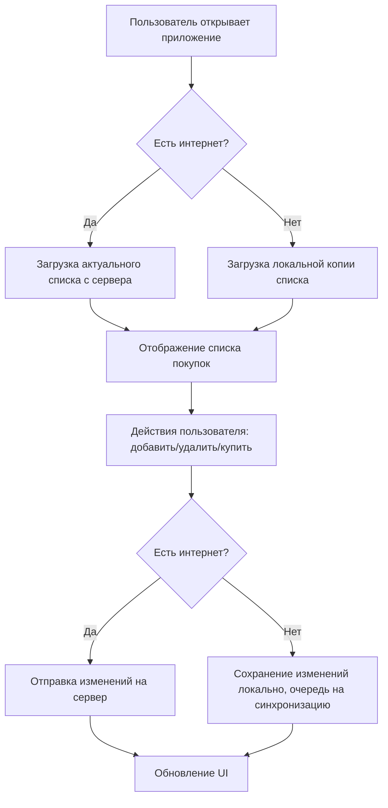

# 1. Бизнес-логика мобильного приложения

Основной сценарий: пользователь открывает приложение, работает со списком покупок (добавляет, удаляет, отмечает купленное), данные синхронизируются с сервером.

