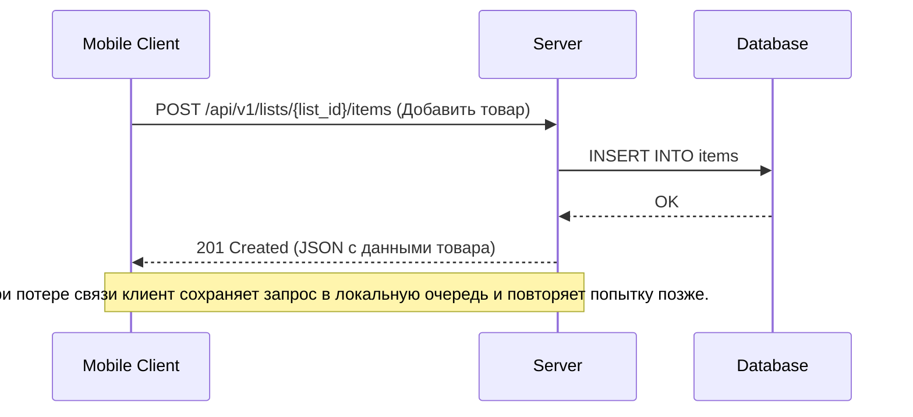

# 3. Процесс синхронизации данных и API

В данном разделе описан базовый процесс синхронизации изменений между мобильным клиентом и сервером. Для разрешения конфликтов используется подход **Last Write Wins** (побеждает последнее изменение).

## Sequence Diagram (Сценарий синхронизации при добавлении товара)

## Описание базовых API-методов

Формат обмена данными: **JSON**. Авторизация: **Bearer Token (JWT)** в заголовке `Authorization`.

*   **`GET /api/v1/lists`** — получить все списки покупок текущего пользователя.
    *   *Ответ (200 OK):* Массив объектов списков с вложенными товарами.
*   **`POST /api/v1/lists`** — создать новый список покупок.
    *   *Тело запроса:* `{"title": "Продукты"}`
    *   *Ответ (201 Created):* Объект созданного списка с присвоенным `id`.
*   **`POST /api/v1/lists/{list_id}/items`** — добавить новый товар в конкретный список.
    *   *Тело запроса:* `{"name": "Молоко", "quantity": 2}`
    *   *Ответ (201 Created):* Объект созданного товара.
*   **`DELETE /api/v1/lists/{list_id}/items/{item_id}`** — удалить товар из списка.
    *   *Ответ (204 No Content):* Успешное удаление, тело ответа пустое.
