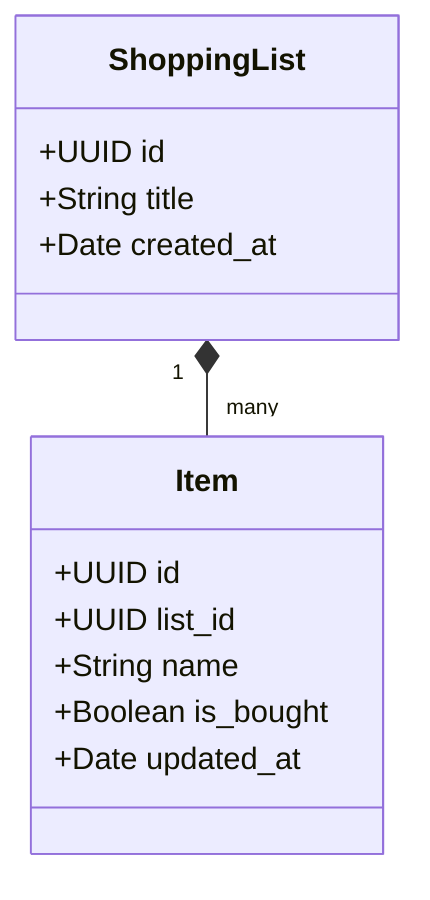

# 4. Детальное описание функции покупки товара

В данном разделе описано, как технически реализуется функция отметки товара как «купленного» (пункт 5 задания).
## UML Диаграмма классов (структура данных)


## API Метод для покупки

**Запрос:** `PATCH /api/v1/lists/{list_id}/items/{item_id}/purchase`
**Заголовки:** `Authorization: Bearer <token>`, `Content-Type: application/json`

**Тело запроса:**
```json
{
  "is_bought": true
}
```
**Успешный ответ(200 OK):**
```json
{
  "id": "550e8400-e29b-41d4-a716-446655440000",
  "name": "Молоко",
  "is_bought": true,
  "updated_at": "2026-11-15T10:00:00Z"
}
```

## Коды ошибок

* `400 Bad Request` — неверный формат переданных данных.
* `404 Not Found` — товар или список не найден.
* `401 Unauthorized` — невалидный или истекший токен авторизации.
* `409 Conflict` — товар уже был отмечен как купленный ранее.

## Хранение информации

Данные хранятся в реляционной БД (например, PostgreSQL).
Основная таблица `items`:
* `id` (UUID, Primary Key) — уникальный идентификатор товара.
* `list_id` (UUID, Foreign Key) — ссылка на список покупок.
* `name` (VARCHAR) — название товара.
* `is_bought` (BOOLEAN, default false) — статус покупки.
* `updated_at` (TIMESTAMP) — время последнего изменения (в UTC).
