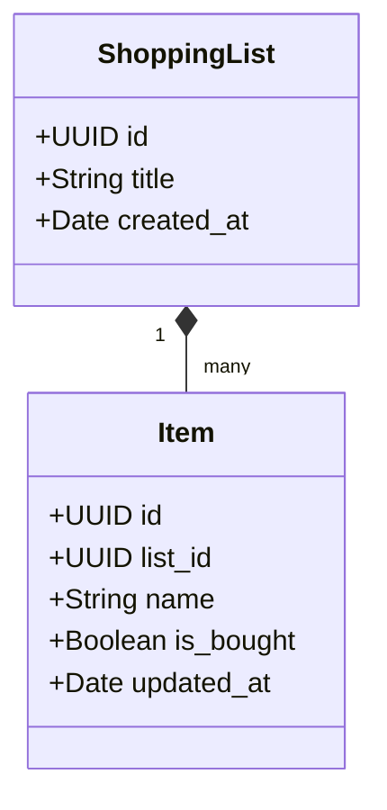

# 4. Детальное описание функции покупки товара

В данном разделе описано, как технически реализуется функция отметки товара как «купленного» (пункт 5 задания).
## UML Диаграмма классов (структура данных)

